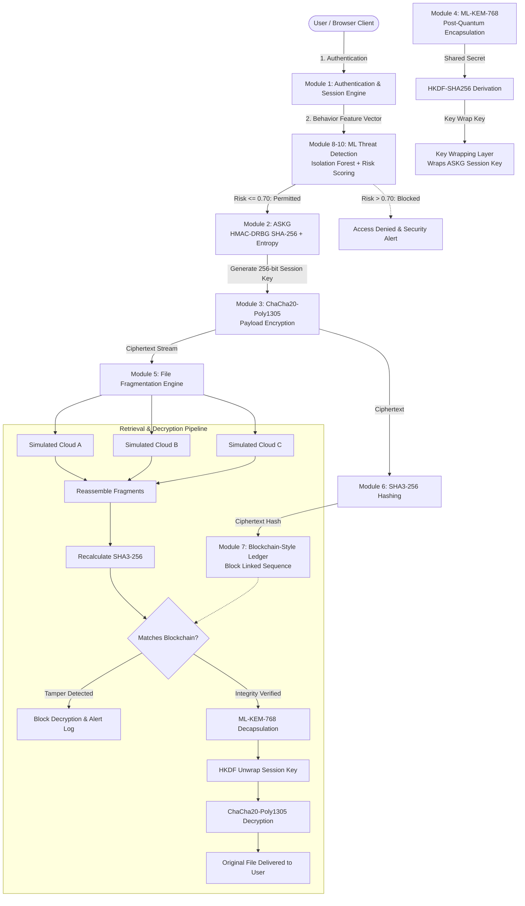

# SecureCloud-X: System Architecture Specification

## 1. Executive Architectural Overview

**SecureCloud-X** is an academic cybersecurity engineering framework designed to secure multi-cloud data storage against both classical and quantum computing threats. It enhances the foundational paradigm established in *"CloudLock: Secure Data Sharing Using a Hybrid Cryptosystem in Multi-Cloud Data Storage"* by replacing legacy pre-quantum key exchange (ECDH) with NIST FIPS 203 post-quantum Key Encapsulation (ML-KEM), embedding an immutable blockchain-style integrity ledger using SHA3-256, integrating real-time behavioral threat detection via scikit-learn Isolation Forest, and implementing an application-level session key generator (ASKG) built on NIST SP 800-90A HMAC-DRBG.

---

## 2. End-to-End System Block Diagram

---

## 3. Cryptographic Key Separation Architecture

To comply with defense-in-depth and avoid key-reuse vulnerabilities, SecureCloud-X enforces strict separation across four distinct cryptographic materials:

| Key Role | Symbol | Size | Algorithm | Source / Generation | Lifespan | Storage Location |
| :--- | :--- | :--- | :--- | :--- | :--- | :--- |
| **Session Key** | $K_{session}$ | 256 bits (32 B) | ChaCha20 | Generated dynamically by ASKG via HMAC-DRBG | Single file encryption/decryption lifecycle | Held strictly in volatile RAM; **NEVER** stored in SQLite or plaintext disk |
| **ML-KEM Shared Secret** | $ss_{kem}$ | 256 bits (32 B) | ML-KEM-768 | Output of ML-KEM encapsulation/decapsulation | Ephemeral during key agreement | Discarded immediately after HKDF expansion |
| **Key Wrapping Key** | $K_{wrap}$ | 256 bits (32 B) | ChaCha20 AEAD | Derived from $ss_{kem}$ via HKDF-SHA256 (`info=b"SecureCloud-X-KeyWrap-v1"`) | Ephemeral during wrap/unwrap | Memory only; discarded after operation |
| **Wrapped Key Payload** | $W_{key}$ | 48 bytes | ChaCha20-Poly1305 | $K_{session}$ encrypted under $K_{wrap}$ + 16-byte Poly1305 tag | Persistent | Stored in SQLite `files.wrapped_session_key` |

---

## 4. Multi-Cloud Storage Abstraction

To ensure portability and immediate demonstration on any Windows/Linux workstation, multi-cloud storage is simulated across three discrete directories:
- `storage_simulation/cloud_A/`: Primary cloud provider replica (e.g., AWS S3 simulation).
- `storage_simulation/cloud_B/`: Secondary cloud provider replica (e.g., Azure Blob simulation).
- `storage_simulation/cloud_C/`: Tertiary cloud provider replica (e.g., Google Cloud Storage simulation).

### Fragmentation Logic:
$$\text{Chunk Size} = \left\lceil \frac{\text{Payload Size}}{3} \right\rceil$$
The ciphertext stream $C$ is partitioned into ordered fragments $F_0, F_1, F_2$. Each fragment is independently hashed using SHA3-256 and stored on its respective provider. Reassembly requires fetching and ordering fragments by index. If any fragment is missing or tampered with, the reassembled SHA3-256 hash fails to match the blockchain record, instantly blocking decryption.
