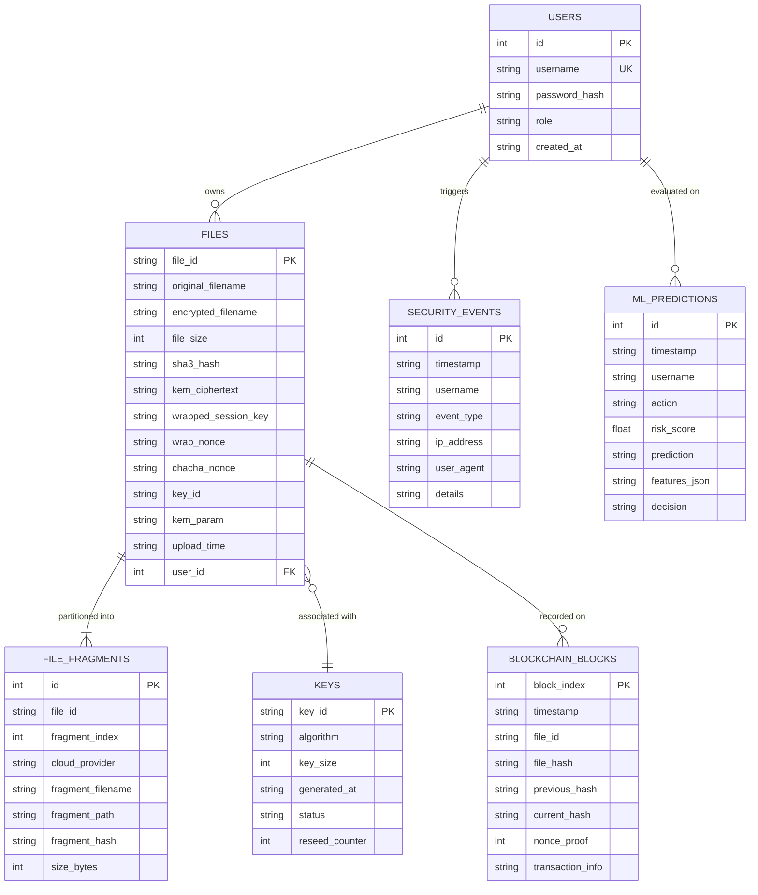

# SecureCloud-X: Database Schema Specification

The SecureCloud-X persistence layer is implemented in SQLite (`database/securecloud.db`). The relational design enforces clean separation between user identities, file metadata, fragment distribution, key lifecycle auditing, blockchain blocks, security logs, and AI predictions.

---

## 1. Relational Entity Relationship Diagram

---

## 2. Table Definitions & Security Constraints

### Table: `users`
- Stores user credentials and authentication roles (`Admin`, `User`).
- Passwords are encrypted using **PBKDF2-HMAC-SHA256** with unique salts. Plaintext passwords are never stored.

### Table: `files`
- Stores cryptographic and storage metadata for uploaded files.
- **Zero Plaintext Key Storage:** Only the hex-encoded ML-KEM encapsulation ciphertext (`kem_ciphertext`), the wrapped session key (`wrapped_session_key`), the wrap nonce (`wrap_nonce`), and payload nonce (`chacha_nonce`) are stored. The session key cannot be decrypted without the system's ML-KEM private key.

### Table: `file_fragments`
- Tracks the physical location and individual SHA3-256 digests of fragments stored across simulated Cloud A, Cloud B, and Cloud C.

### Table: `keys`
- Audits the lifecycle of keys generated by the Adaptive Secure Session Key Generator (ASKG).
- Tracks `key_id`, algorithm (`HMAC-DRBG / SHA-256`), bit length (256), reseed index, and lifecycle status (`Active` or `Rotated`). Raw cryptographic key bytes are never written to this table.

### Table: `blockchain_blocks`
- Implements the append-only integrity ledger.
- Each block links to its predecessor via `previous_hash`, and commits to the file's SHA3-256 ciphertext hash.

### Table: `security_events`
- Records immutable security events for administrative auditing (logins, file encryptions, integrity verifications, tamper detections, access blocks).

### Table: `ml_predictions`
- Records runtime threat evaluations made by the Isolation Forest model, including input feature vectors, computed risk scores, and access control decisions (`ALLOW`, `WARN`, `BLOCK`).
